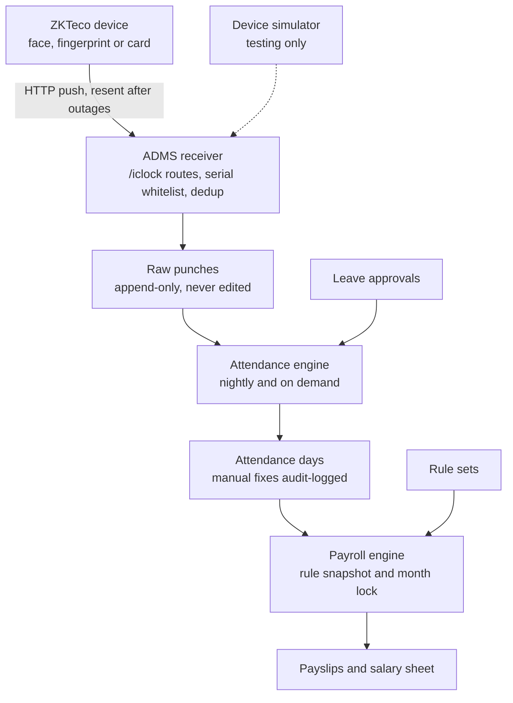

# byTeam: MVP Design

Last updated: 24 October 2026

## Overview

One internal web app for the Sand'Sun office that turns face and fingerprint punches into attendance, leave and a monthly salary sheet. It runs for one company, one office and one ZKTeco device for now.

**In scope:** employees, one ADMS-capable device, shifts, daily attendance, leave with admin approval, monthly payroll with payslips.

**Out of scope for MVP:** employee self-service app, overtime and night shifts, tax and provident fund, loans, geofenced check-in, Hikvision, multiple branches or tenants, SMS and email alerts.

**Payroll decisions (made 2026-10-24, all editable as settings)**

- Absent day deduction base: gross
- Divisor: working days in the month
- Late policy: every 3 lates cost one day, grace minutes come from the shift
- Weekly off days: Friday and Saturday
- Leave quotas: per calendar year

## Architecture



Punches flow one way from the device to the payslip. Only the raw punch log is permanent; attendance days and payroll items are derived and can be rebuilt whenever a rule, leave or punch changes, until the month is finalized.

## Tech stack

One Next.js app holds the admin UI, the API and the ADMS receiver, so testing and production run the same code.

| Layer | Choice | Note |
| --- | --- | --- |
| App | Next.js (App Router) + TypeScript | UI, server actions, `/iclock` routes |
| Database | PostgreSQL | Neon free tier for testing, self-hosted on the VPS later |
| ORM | Drizzle (postgres.js driver) | Unique constraints do the punch dedup |
| Auth | Better Auth, email + password | Two roles: Owner, HR |
| UI | Tailwind + shadcn/ui | Tables, calendar grid, forms |
| Exports | exceljs, react-pdf | Salary sheet, payslips |
| Tests | Vitest | Rule and payroll calculations |
| Hosting (testing) | Vercel Hobby + Neon; device tested on office LAN against a laptop | No paid plan needed |
| Hosting (production) | One VPS with Nginx, Postgres, system cron | Plain HTTP for the device, HTTPS for admin |

## Data model

18 tables in four groups. Raw punches are append-only; everything computed from them can be deleted and rebuilt.

**Setup**

| Table | Purpose | Key fields |
| --- | --- | --- |
| users | Admin logins | email, password\_hash, role (owner, hr) |
| company\_settings | One row of company config | weekly\_off\_days, timezone (Asia/Dhaka), currency |
| holidays | Public holiday calendar | date, name |
| shifts | Working hours | name, start\_time, end\_time, grace\_minutes |
| employees | Staff records | emp\_code (matches device PIN, unique), name, department, designation, join\_date, exit\_date, shift\_id, active |
| salary\_structures | Pay per employee, versioned | employee\_id, gross, basic\_pct, house\_pct, medical\_pct, conveyance\_pct, effective\_from |
| rule\_sets | Late and deduction rules, versioned | effective\_from\_month, late\_mode (none, days\_per\_lates, fixed\_per\_late), late\_every\_n, late\_amount, deduction\_base (gross, basic), divisor (thirty, month\_days, working\_days), unpaid\_leave\_as\_absent |

**Device**

| Table | Purpose | Key fields |
| --- | --- | --- |
| devices | Serial whitelist and health | serial\_no (unique), name, last\_seen\_at, active |
| raw\_punches | Every punch as received | device\_sn, emp\_code, punched\_at, status\_code, verify\_code, raw\_line, received\_at; unique (device\_sn, emp\_code, punched\_at) |
| device\_commands | Queue for commands to the device | device\_sn, command, status (pending, sent, done, failed), result |

**Attendance and leave**

| Table | Purpose | Key fields |
| --- | --- | --- |
| attendance\_days | One computed row per employee per day | employee\_id, date, first\_in, last\_out, status (present, late, absent, leave\_paid, leave\_unpaid, weekly\_off, holiday), late\_minutes, early\_minutes, flags (missing\_out, worked\_on\_off\_day), is\_manual |
| attendance\_adjustments | Manual fixes on top of computed data | employee\_id, date, field, new\_value, reason, created\_by |
| leave\_types | Leave categories | name, yearly\_quota, is\_paid |
| leave\_requests | Leave entries | employee\_id, leave\_type\_id, from\_date, to\_date, days, status (pending, approved, rejected), approved\_by |

**Payroll and audit**

| Table | Purpose | Key fields |
| --- | --- | --- |
| payroll\_runs | One per month | month, status (draft, finalized), version, rule\_set\_snapshot (json), finalized\_by, finalized\_at |
| payroll\_items | One per employee per run | run\_id, employee\_id, payable\_days, absent\_days, late\_count, unpaid\_leave\_days, gross, deductions, additions, net, breakdown (json) |
| payroll\_adjustments | Bonus, advance, other | employee\_id, month, type (bonus, advance, other\_addition, other\_deduction), amount (always positive), note |
| audit\_log | Who changed what | actor\_id, action, entity, entity\_id, before (json), after (json), created\_at |

Store money as numeric(12,2) and round net pay to whole taka at the end.

## Device integration

The device calls our server over plain HTTP using ZKTeco's ADMS (Push) protocol; we never call the device.

| Method and path | Device sends | We reply |
| --- | --- | --- |
| GET `/iclock/cdata?SN=...&options=all` | Handshake on boot and reconnect | Config: send punches in real time, last stamp we hold |
| POST `/iclock/cdata?SN=...&table=ATTLOG` | Punch lines, tab-separated: PIN, time, status, verify | `OK` after saving |
| POST `/iclock/cdata?SN=...&table=OPERLOG` | User and admin events on the device | `OK` (logged, not used in MVP) |
| GET `/iclock/getrequest?SN=...` | Polls every few seconds | `OK`, or the next pending command |
| POST `/iclock/devicecmd?SN=...` | Result of a command | `OK`, marks the command done |

**Receiver rules**

- Unknown or inactive serial number: reject and log. Known: update `last_seen_at`.
- Every ATTLOG line goes through an adapter that returns one standard punch: device\_sn, emp\_code, punched\_at, verify method, raw\_line. A future Hikvision adapter returns the same shape.
- Insert with the unique key and ignore conflicts, so resent logs after an outage never create duplicates.
- Device times are read as Asia/Dhaka. Unknown emp\_code is still saved, then shown as an "unmatched punch" for HR.
- A late batch of punches marks those dates for recalculation.
- Rate limit, kept in the memory of the running server (no outside service): 60 requests a minute per device and address, and an address that gets 20 requests refused in a minute (unknown or malformed serial numbers) is turned away early for the rest of that minute. Over the limit the reply is 429 with `Retry-After`, and the device simply tries again. A real device sends a few requests a minute. On a host that runs several copies of the server each copy counts for itself.

**Clock check.** A device only tells us when each punch happened, so on every upload we compare the newest punch time with the moment we received it and keep the latest estimate on the device (`clock_offset_seconds`, positive when the device is ahead). More than 5 minutes either way flags the device on the Devices screen. A punch dated in the future proves the device is ahead, whatever the upload size. A lag is only believed for an upload of 3 punches or fewer, because a device sends a backlog after an outage and its newest punch is then old even with a perfect clock. A later punch that shows the clock is right clears the flag. A gap of whole hours usually means the device time zone is wrong.

**Pushing employees to the device:** adding an employee in the app queues a user-update command, so the device PIN always equals `emp_code`. Face and fingerprint enrollment still happens at the device.

Check exact field order and the handshake reply against the real firmware during the LAN test; firmware versions differ.

## Attendance engine

One pure function, `computeDay(employee, date)`, rebuilds an `attendance_days` row from raw punches, shift, calendar, leave and adjustments. Because it only reads inputs, any day can be recalculated safely.

**When it runs**

- Nightly for the previous day
- On demand for a date range: late punch batch, leave approved or cancelled, manual adjustment, shift or rule change
- Never for a month whose payroll is finalized

**Steps for one employee on one date**

1. Skip dates before join\_date or after exit\_date.
2. Day type: holiday, then weekly off, else working day.
3. Collect that date's punches. First punch is in, last punch is out. One punch only sets the `missing_out` flag.
4. Working day with no punch: absent. Punches on an off day or holiday: keep the day type and set `worked_on_off_day`.
5. Late if first\_in is after shift start plus grace; store late\_minutes. Early if last\_out is before shift end; store early\_minutes.
6. Approved leave covering the date turns absent into leave\_paid or leave\_unpaid.
7. Apply manual adjustments last and set `is_manual`.

**Status priority:** holiday and weekly off, then leave, then present or late, then absent.

**Office outages.** HR records a date and a time window (Settings, Office outages) when the power or the device was off and people could not punch. It changes two steps for everyone that day, and writes one audit row:

- Late: if an outage was on at the moment the shift start plus grace passes, the on-time limit moves to the end of that outage plus the usual grace (and again if a second outage covers the new limit). An outage that began after that moment, or ended before it, changes nothing.
- Absent: a working day with no punch is not absent when one outage covers the whole shift. It counts as present. A partial outage never excuses a full absence.

Adding or removing an outage recomputes that date. A date in a finalized payroll month is refused.

Times before shift start count from shift start. Night shifts that cross midnight are out of scope, so a day's punches are its calendar date.

## Leave module

HR enters and approves leave on the employee's behalf; there is no employee login in the MVP.

- Leave types carry a yearly quota and a paid or unpaid flag (casual, sick, annual, unpaid).
- A request covers a date range. Its day count skips weekly offs and holidays. Full days only.
- Balance per type = yearly quota minus approved days in the calendar year.
- Approving beyond the balance is blocked, unless HR records the extra days as unpaid.
- Approving, cancelling or editing a request recalculates the attendance days it covers.
- A request inside a finalized payroll month cannot change until the month is unlocked.

Quotas are counted per calendar year by default. The owner can switch to each employee's joining anniversary in Leave types.

## Payroll engine

A payroll run reads one month of attendance days and the rule set in effect for that month, then writes one item per employee. Finalizing it locks the month.

**Formula per employee**

```latex
\text{rate} = \frac{\text{base}}{\text{divisor}}
```

```latex
\text{net} = \text{gross} \times \frac{\text{days employed}}{\text{days in month}} - \text{rate} \times (\text{absent} + \text{unpaid leave}) - \text{late deduction} - \text{advances} + \text{additions}
```

- base = gross or basic, and divisor = 30, days in month or working days, both from the rule set.
- Late deduction: every N lates cost one day at the rate, or a fixed amount per late, or nothing.
- days employed covers joining and leaving mid-month; it equals days in month for everyone else.
- The breakdown json keeps every input and step, so the payslip can show how net pay was reached.

**How the numbers are worked out** (`src/lib/payroll/compute.ts`)

- Days employed run from the join date (or the 1st) to the exit date (or the last day), both included.
- Gross earned is the monthly gross times days employed divided by days in the month. It is stored as the item's `gross`; the full monthly gross is in the breakdown.
- A day of pay is the base divided by the divisor. With the working-days divisor, that is the working days of the whole month (weekly offs and holidays removed), also for people who joined or left mid-month.
- "Every N lates cost one day" counts whole groups: 7 lates at N = 3 cost 2 days.
- Money is counted in whole paisa. Each amount line (absent, unpaid leave, late) is rounded to the paisa, half up. Net pay is rounded to a whole taka once, at the end, half up.
- Days with no attendance row cost nothing and raise a warning. Net pay below zero is kept and raises a warning; nothing is clamped silently.

**Run lifecycle**

1. Create a draft run for the month. Any open recalculation finishes first.
2. The engine computes all items. HR reviews the sheet and fixes attendance or adds bonuses and advances; the draft recomputes.
3. Owner finalizes: the rule set is copied into the run, the month's attendance and leave are locked.
4. Payslip PDFs and the salary sheet (Excel, for bank or bKash) are generated from the finalized items.
5. Unlocking is Owner only, needs a reason, and is written to the audit log with the finalized copy it replaces. The run goes back to a draft with its items as they were and its version raised by one; recompute, then finalize again for a new version.

## Screens and roles

Eight screens cover the MVP. HR runs the daily work; only the Owner changes rules, finalizes payroll and unlocks months.

| Screen | What it shows or does | HR | Owner |
| --- | --- | --- | --- |
| Today | Who is in, late, absent or on leave; device online or offline; unmatched punches | Yes | Yes |
| Employees | List, profile, shift, salary structure, push to device | Yes | Yes |
| Attendance | Monthly calendar grid per employee, day detail with raw punches, manual adjustment with reason, Excel export | Yes | Yes |
| Leave | Requests, approve or reject, balances per employee | Yes | Yes |
| Payroll | Runs by month, draft review, bonuses and advances, payslips, salary sheet | Draft only | Finalize, unlock |
| Settings | Company, holidays, shifts, leave types, devices | Yes | Yes |
| Rules | Late policy and deduction rule sets with effective month | View | Edit |
| Reports | The month in numbers: attendance rate, punctuality, day-by-day chart, teams, most late and absent, payroll cost, six-month net pay trend, CSV download | Yes | Yes |
| Audit log | Every manual change, approval, rule change, finalize and unlock | View | View |

### Date ranges

Attendance and Reports work over a period, not a month: `?from=YYYY-MM-DD&to=YYYY-MM-DD` (the old `?month=YYYY-MM` still works, and no parameter means this month). `src/lib/period.ts` reads it: dates the wrong way round are swapped, anything over 366 days is cut short with a notice, and a nonsense value falls back to this month. The control offers quick choices (this month, last month, last 3 months, last 6 months, this year, last year) and custom dates, with arrows that step by the period's own length. Days after today have no records, so a period reaching into the future simply stops at today. Payroll is worked out for whole months only, so the payroll figures in a report cover the whole months inside the period and say so when some months have no run yet.

### Reports figures

Worked out from the monthly attendance grid by pure functions in `src/lib/reports/`, nothing is stored.

- **Attendance rate:** days attended (late days included) over days attended plus days absent. Leave is left out of both sides, so leave never counts against anyone.
- **On time:** arrivals that were not late over all arrivals.
- **A day off** in the day-by-day chart is a day where every row is a weekly off day or holiday. A day with no rows yet is shown as not happened.
- **Payroll cost** reads the run for the month (draft or finalized) and adds gross and net per department in paisa. The six-month trend reads each month's run total.

## Jobs, security, audit

One scheduled job, a closed device path, and an audit row for every human change.

**Jobs**

- Nightly recalculation of the previous day. Vercel Hobby allows one daily cron, which is enough for testing; production uses system cron on the VPS.
- Recalculation queue: dates marked dirty by late punches, leave or adjustments are recomputed right away in the same request, or by the nightly job if many.
- Device online status is computed on read from `last_seen_at`, so it needs no job. Offline means nothing heard for two quiet windows plus 5 minutes (45 minutes by default), or 15 minutes with quiet polling off.
- Office agent (`agent/`, `docs/OFFICE_AGENT.md`): for devices that cannot push. It reads the device over TCP 4370 (ZKTeco standalone protocol) and talks to `/iclock` exactly like a pushing device under the device's serial, so nothing else in byTeam changes. Requests with `User-Agent: byTeam-agent/...` skip the punch-age clock estimate; the agent reports the offset it measured with `clockOffset` on the handshake.
- Quiet polling (`src/lib/adms/quiet-poll.ts`): a command poll is answered from the server's memory for `ADMS_QUIET_MINUTES` (default 20) after the database was last asked, when the device is known and had nothing waiting. Without it the 30 second poll keeps Neon awake all month, about 180 compute hours against the free plan's 100. Uploads always reach the database. A command queued on another server instance reaches the device within one window; on the same instance, on the next poll.
- Production only: daily `pg_dump` backup kept off the server.

**Security**

- `/iclock` routes accept only whitelisted serial numbers, are rate limited, and can only insert punches or read the command queue.
- Admin routes need a session; role checks run on the server for every action.
- Only the owner may edit pay rules, finalize payroll and unlock a month; HR does everything else, including payroll drafts. `tests/security/role-checks.test.ts` runs every server action as nobody, as a user with an unknown role, as HR and as the owner, and checks every page and download route for its own guard, so a new action that forgets its check fails the build.
- Sign-in guessing is slowed down in the server's memory: 10 failed attempts for one email from one address, or 30 from one address across any emails, turn that address away for 15 minutes, even with the right password. A good sign in clears the count for that email and address. (The sign-in form calls Better Auth directly, which skips Better Auth's own limit on its web route.)
- Admin traffic is HTTPS. The device path stays plain HTTP only where the firmware requires it.
- Passwords hashed with argon2 or bcrypt.

**Audit**

Write an `audit_log` row for: manual attendance adjustment, leave approve or reject or cancel, salary structure change, rule set change, payroll finalize, payroll unlock. Raw punches are never edited, so they serve as their own audit trail.

## Testing plan and build order

Build in six steps, each usable on its own and each closed by a test before the next starts.

| Step | Build | Done when |
| --- | --- | --- |
| 1 | Setup: auth, employees, shifts, holidays, settings | HR can add staff and assign shifts |
| 2 | ADMS receiver + device simulator script | Simulator punches land once each, resent batches create no duplicates |
| 3 | Attendance engine + Today and Attendance screens | Seeded month matches a hand-made expected grid |
| 4 | Leave module | Approved leave turns absent into leave; balances correct |
| 5 | Payroll engine, payslips, salary sheet | Every seeded employee's net pay matches the spreadsheet to the taka |
| 6 | Real device on office LAN, then one parallel month at Sand'Sun | New system and current method agree for the full month |

**Device simulator:** a Node script that sends the handshake, ATTLOG batches, and a delayed burst that imitates an offline device catching up.

**Seed data:** 6 to 8 fake employees, each covering one case: always on time, frequent late, absent with and without leave, forgotten punch-out, double tap, joined mid-month.

**Payroll tests:** calculate each seed employee's expected pay by hand in a spreadsheet, then write those as Vitest cases. Any mismatch is a bug or an undefined rule.

**LAN device test:** laptop runs the app, the device points to the laptop's IP and port. Try enrolling, punching, Wi-Fi off and back on, server restart, and pushing a user from the app.
